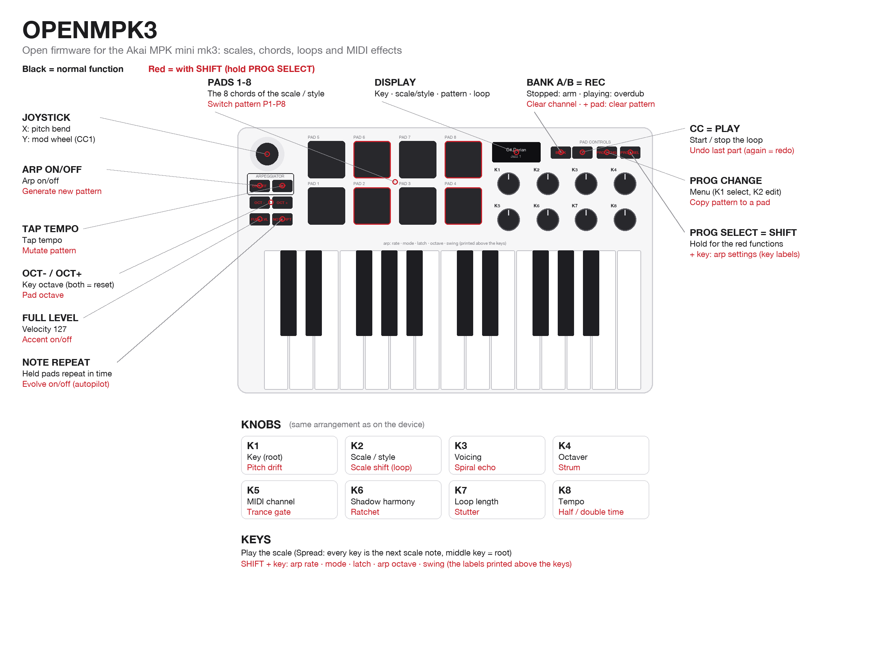

<div align="center">

# OPENMPK3

**Open firmware that turns the Akai MPK mini mk3 into an instrument you can't play wrong.**

Keys locked to a scale · chord pads in 103 styles · a live looper · MIDI effects · generative ideas




</div>

---

## What is this?

The **MPK mini mk3** is a small, popular MIDI keyboard. Out of the box it sends notes and knob moves to your
computer, and that's about it.

**OPENMPK3 replaces the software inside the keyboard** (its firmware) with a new one, written from scratch, that
makes it a real musical instrument:

- 🎹 **Every key is in tune.** Pick a key and a scale, and the keyboard only plays notes that fit, so even a beginner
  sounds good.
- 🟥 **The 8 pads play chords** that go with those notes. Pick a style (Pop, Lo-Fi, Jazz, Synthwave, Cinematic,
  Flamenco, ...) and the pads change to that style's chord progression.
- 🔁 **A built-in looper** records what you play and layers it, like a Korg Kaossilator. It saves 8 patterns.
- ✨ **MIDI effects and generative tools** add echoes, strums, harmonies and stutters, or write a fresh idea for you.

It still works as a normal plug-and-play USB-MIDI keyboard. Plug it into Ableton, Logic, FL Studio, GarageBand or a
hardware synth. Nothing to install on the computer.

> **Is it safe?** Yes. OPENMPK3 never touches Akai's own updater code inside the keyboard. That means you can
> **always go back to the original firmware**, even if something goes wrong. See [Safety](#safety).

---

## What changes on your keyboard

| | Original Akai firmware | OPENMPK3 |
|---|---|---|
| **Keys** | Any note, chromatic | Locked to one of 35 scales, so every key sounds right. Chromatic is still available |
| **Pads** | Drum notes, CC or program change | Chords from the current scale, or from one of **103 styles** |
| **Knobs** | Send MIDI CC | Key, scale/style, voicing, MIDI channel, loop length, tempo, plus 10 effects with SHIFT |
| **Arpeggiator** | 6 modes | 13 modes, set with the labels printed above the keys |
| **Looper** | None | Overdub looper with 8 patterns, undo, several MIDI channels in one loop |
| **Effects** | None | Echo, strum, harmony, octaver, ratchet, trance gate, stutter, half/double time, ... |
| **Generative** | None | Generate a new idea, mutate it, or let it evolve on its own |
| **Display** | Parameter readout | Key and scale, the chord name with a mini keyboard, loop status |
| **Sync** | USB MIDI clock | USB MIDI clock, bar-locked to Ableton. Optional analog clock in/out with a small mod |

---

## Highlights

### 🎼 Harmony that always works
- **35 scales:** the classic modes, plus pentatonics, blues, Japanese, Indian, Middle-Eastern, Balkan and jazz scales.
- **103 chord styles**, each with 8 chords on the pads:
  - Pop and Ballad
  - Lo-Fi, Neo Soul, R&B and Gospel
  - Jazz 1-6, Bossa and Tango
  - Synthwave, Vaporwave, Techno, House, Drum & Bass and Dubstep
  - Cinematic, Horror, Sci-Fi and Fantasy
  - Flamenco, Klezmer, Bollywood, Afrobeat and many more
- **Pads and keys always agree.** Every chord is built only from notes of the scale the keys play, and an automated
  test checks this for every style, every key and every voicing.
- **Smooth voicing** keeps chords in one register, so moving between pads sounds like a pianist, not a robot. Each
  style picks a fitting voicing (jazz opens up wide, gospel adds a bass note), and you can change it.

### 🔁 A looper made for jamming
- **Press REC and just play.** The loop starts on your first note.
- **Overdub layer after layer.** Undo the last part, or clear one channel.
- **8 patterns**, saved automatically. Switching patterns waits for the end of the loop, like a groovebox.
- **Several instruments in one loop:** record a bass on channel 1, a lead on channel 2, chords on channel 3.
- **Locks to Ableton's bars** when synced, and follows Play and Stop.

### ✨ Effects and ideas (hold PROG SELECT)
- **Spiral echo** climbs the scale as it repeats. **Strum** rolls chords like a guitar.
- **Shadow harmony** adds a second voice. **Octaver** layers octaves.
- **Ratchet** and **trance gate** add rhythm.
- **Stutter** repeats a slice of the loop, and **half/double time** changes its speed.
- **Generate** writes a new chord-and-melody pattern. **Mutate** varies it. **Evolve** lets the loop change slowly by
  itself while you play over it.

The full list of controls is in the **[user manual](docs/MANUAL.md)**.

---

## Get started

### What you need
- An **Akai MPK mini mk3** with USB product ID **0x0049**. That's most units. To check on macOS, open System
  Information → USB → *MPK mini 3*. Units with ID 0x1049 use a different chip and are not supported yet.
- A computer with **Python 3** and this repository (*Code → Download ZIP*, or `git clone`).

```bash
pip3 install mido python-rtmidi hidapi
```

### 1. Get Akai's original firmware (one time)
OPENMPK3 keeps Akai's updater inside the keyboard, so flashing needs Akai's official firmware file. This script
downloads it straight from Akai's server and checks it. It's also your way back to stock.

```bash
python3 tools/get_stock_firmware.py
```

### 2. Get OPENMPK3
Download the latest **`openmpk3-vX.Y.bin`** from the [Releases page](../../releases/latest) and put it in the
repository folder. No compiler needed.

Or build it yourself (needs the ARM GCC toolchain):

```bash
cd firmware && make        # result: firmware/build/openmpk3_full.bin
```

### 3. Put the keyboard in update mode
Unplug it. **Hold BANK A/B + PROG SELECT** and plug it back in. The screen says **"Upgrade"**.

### 4. Flash

```bash
python3 tools/mpk_flash.py flash openmpk3-v0.8.bin --write          # a downloaded release
python3 tools/mpk_flash.py flash firmware/build/openmpk3_full.bin --write   # or your own build
```

After about 40 seconds the keyboard restarts as **OPENMPK3**. Open the [manual](docs/MANUAL.md) and start playing.

> Release files contain **only OPENMPK3's own code**. The flasher adds Akai's bootloader from the file you
> downloaded in step 1, exactly as the build does. No Akai firmware is ever distributed here.

### Going back to the original firmware
Enter update mode again (step 3), then flash Akai's file:

```bash
python3 tools/mpk_flash.py flash stock/MPKmini3_v1.26_STM32F070_pid0049.bin --write
```

Akai's own updater app works too.

---

## Safety

- **The recovery mode can't be overwritten.** Akai's bootloader, the part that provides update mode, is never
  modified. The flasher refuses any image whose bootloader area isn't exactly Akai's original, byte for byte. If the
  firmware ever misbehaves, BANK + PROG SELECT at power-up still gets you back to update mode.
- **Flashing erases settings and patterns.** That's how Akai's update process works, so save anything you want to
  keep first.
- **Use at your own risk.** This is a community project, not supported by Akai. Opening the unit for the optional
  clock mod voids the warranty.

Technical details are in [docs/update-protocol.md](docs/update-protocol.md).

---

## Optional hardware mod: analog clock in/out

The keyboard has a small debug header inside (TE1). With two resistors and two diodes, it can take a **modular /
Eurorack clock in** and send a **clock out**.

<details>
<summary>Wiring and settings</summary>

TE1 carries SWDIO (PA13), SWCLK (PA14), NRST, 3.3 V and GND. Check the pads with a multimeter first.
`python3 tools/mpk_debug.py probe` shows whether the pins are free.

**Clock in on PA13 (SWDIO).** In the menu, set *Clock in TE1 → On* and *Clk in input → Direct*.

```
 jack tip ──┬── 10k ──┬── PA13            2x BAT41 / BAT85 or BAT54S:
            │         ├──|>|── 3.3V (TE1)   pin -> 3.3V clamp (band to 3.3V)
          100k        └──|<|── GND          GND -> pin clamp (band to pin)
            │
 sleeve ───GND
```

The transistor alternative (2N3904, 10k base resistor, 100k base to GND, collector on PA13) takes 3-15 V pulses.
For it, choose *Clk in input → Transistor*. The clock rate can be 1, 2, 4 or 24 PPQN. The clock input has priority
over USB clock, and the loop locks to it.

**Clock out on PA14 (SWCLK).** In the menu, set *TE1 pin 2 → Clock out*. You get 3.3 V, 5 ms pulses at 1, 2, 4 or
24 PPQN.

```
 PA14 ── 470R-1k ──┬── jack tip       optional: BAT41 from PA14 side of the resistor to 3.3V (band to 3.3V)
 GND ──────────────┴── jack sleeve
```

</details>

---

## For developers

The firmware is plain C on the STM32F070RB (Cortex-M0, 128 KB flash, 16 KB RAM). It uses
[TinyUSB](https://github.com/hathach/tinyusb) for USB-MIDI. The music engine has no hardware code, so it is tested
on your computer:

```bash
cd firmware && make test
```

| Path | What's inside |
|---|---|
| `firmware/core/` | Music engine: scales, chord styles and voicing, arpeggiator, looper, MIDI effects, generator (host-tested) |
| `firmware/src/` | Board drivers (keys, pads, knobs, LEDs, OLED), USB-MIDI, app logic, display, flash storage |
| `firmware/test/` | Host unit tests |
| `tools/` | Flasher, image packer, stock-firmware fetcher, live diagnostics, manual image generator |
| `docs/` | Manual, architecture, hardware map, bootloader protocol |

**Documentation:**
- [User manual](docs/MANUAL.md): every control
- [Architecture](docs/ARCHITECTURE.md): firmware structure, memory map, timing
- [Hardware map](docs/hardware-map.md): pins and peripherals, reverse-engineered from the stock firmware
- [Update protocol](docs/update-protocol.md): Akai's HID bootloader and why flashing is safe
- [Changelog](CHANGELOG.md)

**Diagnostics while it runs:**

```bash
python3 tools/mpk_debug.py 20      # key timing, loop time, tempo source
python3 tools/mpk_debug.py probe   # spare chip pins
```

---

## Credits

- [TinyUSB](https://github.com/hathach/tinyusb) (MIT), ST and ARM CMSIS headers (Apache-2.0).
- Earlier community research that made this possible:
  - [MPKill8](https://github.com/jrold/MPKill8) (mk3 firmware notes)
  - [mpk3-settings](https://github.com/tsmetana/mpk3-settings) (mk3 SysEx)
  - [MPK-Mini-open](https://github.com/craigsblackie/MPK-Mini-open) (open firmware for the original MPK mini)

## License

[MIT](LICENSE): free to use, change and share. Third-party code in `firmware/lib/` keeps its own license (TinyUSB:
MIT; CMSIS: Apache-2.0).

## Disclaimer

OPENMPK3 is an independent community project. It is **not affiliated with, endorsed by, or supported by Akai
Professional or inMusic Brands**. "Akai", "MPK" and "MPK mini" are trademarks of their respective owners. This
repository contains no Akai firmware. The stock image is downloaded from Akai's server by the user.
