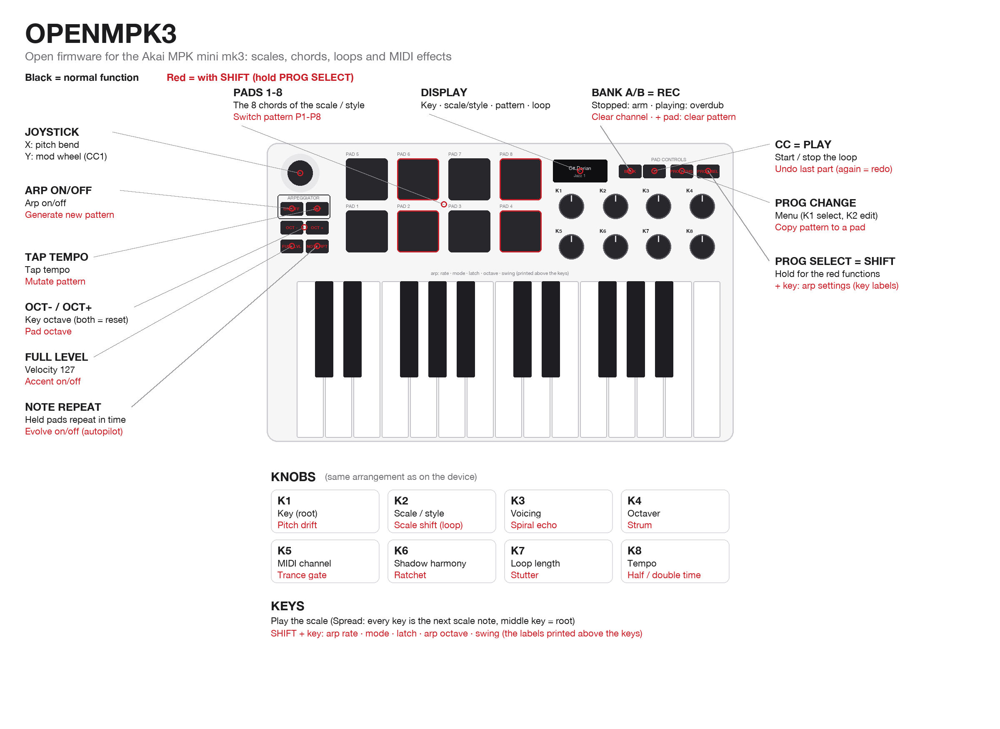

# OPENMPK3 manual



**Black** = normal function. **Red** = with **SHIFT**, which means holding **PROG SELECT**.

---

## 1. The idea

- The **keys** always play the notes of a scale, so nothing sounds wrong.
- The **pads** play the 8 chords that belong to that scale (or to a *style*).
- The **looper** records everything you play into 8 patterns.
- **MIDI effects** shape what you hear without changing what was recorded.

## 2. Sound: key, scale, style

| Control | Function |
|---|---|
| **K1** | Key (root note) |
| **K2** | Scale or style: one list with 35 scales first, then 103 styles (numbered 001-103) |
| **K3** | Voicing of the pad chords: Smooth, +Bass, Open, Wide, High, Low |

**Scales.** The keys play the scale. Pads 1-7 play its chords (I to VII) and pad 8 plays the I chord higher.
The menu setting **Scale chords** picks Triads, 7ths, 9ths, Add9, Sus2, Sus4, 6ths, 11ths, Power or 4ths.

The 35 scales:

- **Modes:** Major, Minor, Dorian, Phrygian, Lydian, Mixolydian, Locrian
- **Minor and major variants:** Harmonic and Melodic minor, Harmonic major, Mixolydian b6, Dorian b2, Lydian dominant,
  Lydian augmented
- **Pentatonic, hexatonic and blues:** Major/Minor pentatonic, Major/Minor hexatonic, Blues, Major blues, Afro pentatonic
- **Asian and world:** Japanese (In), Hirajoshi, Kumoi, Pelog, Slendro, Egyptian, Hijaz, Bhairav, Hungarian minor,
  Neapolitan minor, Ukrainian Dorian
- **Jazz:** Bebop, Bebop minor
- **Other:** Whole tone

**Voicing presets.** Choosing a style, or some of the scales, also loads a voicing that suits it. Jazz styles load
Wide or Open, gospel loads +Bass, cinematic styles load Wide, and so on. The popup shows it, for example
`STYLE - Wide`. You can change it afterwards with K3, and a saved pattern remembers the voicing you used.

**Styles.** The pads play the style's 8 chords and the keys play its matching scale. Every chord uses only notes of
that scale. Styles are grouped by family, with variants next to each other (Jazz 1, Jazz 2, ...). While you turn K2,
the popup shows the style's number top right, so you can find it again:

| No. | Family | Styles |
|---|---|---|
| 001-011 | **Pop** | `001` Pop 1 · `002` Pop 2 · `003` Pop 3 · `004` Pop 4 · `005` K-Pop Anime · `006` Dance / EDM · `007` Hyperpop · `008` Tropical · `009` City Pop 1 · `010` City Pop 2 · `011` 8-Bit Game |
| 012-018 | **Ballads and sad** | `012` Ballad · `013` Romantic · `014` Lullaby · `015` Sad 1 · `016` Sad 2 · `017` Sad 3 · `018` Sad 4 |
| 019-028 | **Soul, R&B, funk, gospel** | `019` Neo Soul 1 · `020` Neo Soul 2 · `021` Neo Soul 3 · `022` R&B · `023` Soul 70s · `024` Funk · `025` Disco Funk · `026` Gospel 1 · `027` Gospel 2 · `028` Blues |
| 029-032 | **Lo-Fi** | `029` Lo-Fi 1 · `030` Lo-Fi 2 · `031` Lo-Fi 3 · `032` Chill Hop |
| 033-043 | **Jazz and Latin** | `033` Jazz 1 · `034` Jazz 2 · `035` Jazz 3 · `036` Jazz 4 · `037` Jazz 5 · `038` Jazz 6 · `039` Bebop · `040` Bossa 1 · `041` Bossa 2 · `042` Latin · `043` Tango |
| 044-062 | **Electronic** | `044` Synthwave 1 · `045` Synthwave 2 · `046` Synthwave 3 · `047` Synthwave 4 · `048` Vaporwave 1 · `049` Vaporwave 2 · `050` Vaporwave 3 · `051` Techno 1 · `052` Techno 2 · `053` Techno 3 · `054` House 1 · `055` House 2 · `056` Afro House · `057` Amapiano · `058` UK Garage · `059` Drum & Bass · `060` Dubstep · `061` Rave · `062` Trap Dark |
| 063-067 | **Rock** | `063` Post-Rock · `064` Shoegaze · `065` Math Rock · `066` Punk · `067` Metal |
| 068-083 | **Cinematic and moods** | `068` Cinematic 1 · `069` Cinematic 2 · `070` Cinematic 3 · `071` Cinematic 4 · `072` Heroic · `073` Fantasy · `074` Fairytale · `075` Thriller · `076` Horror · `077` Spy Movie · `078` Noir · `079` Sci-Fi · `080` Dream · `081` Ethereal · `082` Ambient · `083` Lydian Dream |
| 084-103 | **World** | `084` Country · `085` Reggae · `086` Celtic 1 · `087` Celtic 2 · `088` Flamenco · `089` Napoli 1 · `090` Napoli 2 · `091` Klezmer · `092` Balkan · `093` Middle East · `094` Indian 1 · `095` Indian 2 · `096` Bollywood · `097` Afrobeat · `098` Highlife · `099` Ethio Jazz · `100` Japan · `101` Japan In · `102` China · `103` Bali Gamelan |

**Keys layout** (menu **Key map**):

- **Spread** (default): every key plays the next scale note; the middle key is the root.
- **WhiteKeys**: white keys play the scale, black keys add a third above.
- **Chromatic**: a normal keyboard.

**Octaves.** OCT- / OCT+ shift the keys. SHIFT + OCT- / OCT+ shifts the pads.

**OCT- + OCT+ together** resets both octaves and works as a **panic** button: it sends All Notes Off on all 16
channels, in case a connected synth is still holding a note.
The display shows `O+1` for the keys and `PO+1` for the pads, bottom right.

## 3. Looper and patterns

| Control | Function |
|---|---|
| **REC** (BANK A/B) | Stopped: arm. The first note you play starts the loop and the recording. Playing: overdub on/off |
| **PLAY** (CC) | Start / stop. Stopping also sends All Notes Off on every channel the loop uses |
| **K7** | Loop length: 1/2, 1, 2, 4, 8 or 16 bars |
| **K8** | Tempo |
| **TAP TEMPO** | Tap the tempo |
| **SHIFT + pad 1-8** | Switch pattern P1-P8. While playing, the switch happens at the end of the loop (`P1->P4` blinks) |
| **SHIFT + PROG CHANGE, then a pad** | Copy the current pattern to that pad |
| **SHIFT + REC** (release) | Clear the current MIDI channel in this pattern |
| **SHIFT + REC + pad** | Clear that pattern completely |
| **SHIFT + PLAY** | Undo the latest part |

- **What a "part" is.** Everything recorded from pressing REC until you turn overdub off, or until you change MIDI
  channel. Recording on channel 1 and then switching K5 to channel 2 while still recording makes two parts, so undo
  takes back only the channel 2 part.
- **Repeat to undo.** If you repeat any of the last three shortcuts straight away, before touching anything else, it
  restores what it removed.
- **Undo and clear don't interrupt anything.** The rest of the loop keeps sounding, and if you were recording, you
  still are.
- **Memory.** A pattern holds about 300 notes. When it's full the screen shows `LOOP FULL` and new notes are played
  but not recorded. Undo or clear a part to make room.
- **Saving.** Patterns save to flash by themselves: when you switch away, when you stop, or after a few idle seconds.
- **What a pattern remembers.** Its notes, loop length, scale/style, key and tempo. When synced to an external clock,
  the external tempo is used instead of the saved one.
- **Pad LEDs.** Hold SHIFT to see the patterns on the pads: current = bright (pulsing while playing), stored = dim,
  empty = off, queued = fast blink.

**Several instruments in one loop.** Use **K5** to pick a MIDI channel (1-16) and record a bass. Switch K5 to another
channel and overdub a lead. Every part plays back on its own channel.

## 4. Arpeggiator

- **ARP ON/OFF** turns the arp on or off. Keys and pads then feed the arp.
- **Hold SHIFT (PROG SELECT) + a key** to change the arp settings. The labels printed above the keys show what each key does:

| Keys | Setting |
|---|---|
| 1-8 | Rate: 1/4, 1/4T, 1/8, 1/8T, 1/16, 1/16T, 1/32, 1/32T |
| 9-14 | Mode: UP, DOWN, EXCL, INCL, ORDER, RAND. Press the same key again for ScaleWalk, Converge, Bounce, Pinky, Thumb, Chord |
| 15 | LATCH |
| 16-19 | ARP OCT 1-4 |
| 20-25 | SWING 50, 55, 57, 59, 61, 64 % |

Arp gate and accent are in the menu. The looper records the arp's output.

## 5. MIDI effects

The effects shape everything you hear, but the looper records your playing without them. That means you can change
them on a recorded loop at any time.

| Knob | Effect | What it does |
|---|---|---|
| **K4** | Octaver | Adds +1, -1, +2, -2 or ±1 octave copies |
| **K6** | Shadow harmony | Adds a second voice in the scale: +3rd, +4th, +5th, +6th, -3rd, -4th, 3rd+5th |
| **SHIFT + K1** | Pitch drift | Notes wander up to ±7 scale steps, always in key |
| **SHIFT + K2** | Scale shift | Moves the loop -7 to +7 scale steps while you play over it |
| **SHIFT + K3** | Spiral echo | Tempo-synced echoes that climb one scale step per repeat |
| **SHIFT + K4** | Strum | Chord notes rolled down and up like a guitar (0-60 ms) |
| **SHIFT + K5** | Trance gate | 8 rhythmic chop patterns on the 1/16 grid |
| **SHIFT + K6** | Ratchet | Every note fires 1-4 fast 1/32 repeats |
| **SHIFT + K7** | Stutter | Repeats a 1/4, 1/8, 1/16 or 1/32 slice of the loop. Back to Off releases it |
| **SHIFT + K8** | Loop speed | Half time, normal or double time |

## 6. Generative

| Control | Function |
|---|---|
| **SHIFT + ARP ON/OFF** | **Generate**: writes a new idea into the current pattern (chords on a Euclidean rhythm plus a melody in the scale) and starts it |
| **SHIFT + TAP TEMPO** | **Mutate**: varies about 15% of the notes in pitch, timing or velocity |
| **SHIFT + FULL LEVEL** | **Accent**: strong downbeats and ghost notes on the loop and the arp (on/off) |
| **SHIFT + NOTE REPEAT** | **Evolve**: the loop mutates a little every 2 cycles. The LED blinks while it is on |

After Generate or Mutate, **SHIFT + PLAY** goes back to the pattern as it was before.

## 7. Other controls

| Control | Function |
|---|---|
| **FULL LEVEL** | Every note at velocity 127 |
| **NOTE REPEAT** | Held pads repeat at the repeat rate (set in the menu) |
| **Joystick** | X: pitch bend · Y: mod wheel (CC1) |
| **Pedal** | Sustain (CC64) |
| **PROG CHANGE** | Opens the menu. **K1** picks a setting, **K2** changes it, PROG CHANGE again closes it |

**Menu settings:**

- **Keys:** Key map, Scale chords, Velocity curve, Key sensitivity
- **MIDI:** MIDI channel
- **Looper:** Quantize on/off and grid
- **Clock:** Clock source, Clock out (USB), Clock in TE1, Clock-in rate and input type, TE1 pin 2 (reset in / clock out), Clock-out rate
- **Arp and repeat:** Arp gate, Arp accent, Repeat rate
- **Joystick:** invert X / Y

## 8. Sync and clock

- **Ableton / USB MIDI clock.** In Ableton, enable **Sync** for the OPENMPK3 output port. The tempo readout then
  shows `e`. The loop locks to Ableton's bars and follows Start, Stop and song position.
- **Analog clock in (TE1 header, SWDIO / PA13).** Turn on **Clock in TE1** in the menu and choose the PPQN. The
  readout shows `c`. Wiring is in the [README](../README.md).
- **Analog clock out (TE1 SWCLK / PA14).** Set **TE1 pin 2 → Clock out** in the menu: 3.3 V, 5 ms pulses.

## 9. The display

- **Top left:** the style name, or `PATTERN n` when a plain scale is selected.
- **Top right:** the tempo, or the loop state (`PLAY`, `REC`, `ARM`, `P1->P4`) with the loop length below it.
- **Middle:** the key and scale. While you play, it shows the chord with a mini keyboard, or the note.
- **Bottom:** the loop progress bar, with the octave shifts at the right.

## 10. Updating and recovery

Unplug the MPK, hold **BANK + PROG SELECT**, and plug it back in. The screen shows `Upgrade`. Then run:

```
python3 tools/mpk_flash.py flash firmware/build/openmpk3_full.bin --write
```

To go back to Akai's original firmware, run `python3 tools/get_stock_firmware.py` once, then flash
`stock/MPKmini3_v1.26_STM32F070_pid0049.bin` the same way (or use Akai's own updater app).

Flashing erases settings and patterns (Akai's bootloader wipes the whole application area).
